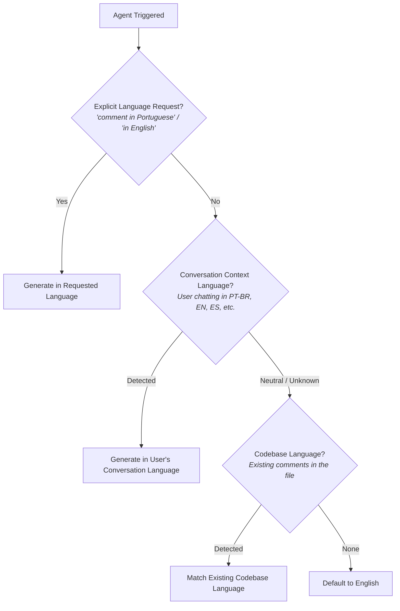

# Antigravity Didactic Comments Skill (`didactic-code-explainer`)

> 🌐 **Language / Idioma**: **🇺🇸 English** | [🇧🇷 Versão em Português (README.pt-BR.md)](README.pt-BR.md)

[](LICENSE)
[](#installation--setup)
[](#installation--setup)

A production-ready **Custom Skill for Google Antigravity** designed to standardize educational code formatting, initial contract declarations, visual phase boundaries, and conceptual **"why"** comments.

Ideal for technical educators, codebase onboarding, documentation authors, and engineering teams that value pristine readability and pedagogical depth over boilerplate noise.

---

## 🎯 Purpose & Philosophy

Code comments frequently suffer from two anti-patterns:
1. **Total Absence of Documentation**: Complex business logic, subtle type constraints, and runtime edge cases remain tribal knowledge.
2. **Tautological / Obvious Noise**: Pointless syntax restatements like `i++ // increment i` or `return true // returns true` that clutter the codebase without providing conceptual value.

The **Didactic Comments Skill** enforces a disciplined, repeatable standard built upon **Three Core Pillars**:

1. **Initial Structured Contract**: Every function, method, or key module starts with an explicit header defining the pedagogical objective, input parameter constraints, and return contract.
2. **Visual Logical Block Boundaries**: Code execution is partitioned into clearly demarcated, numbered logical phases (e.g., `1. BUSINESS RULE VALIDATION`, `2. FALLBACK RETURN FLOW`) with standardized spacing.
3. **Conceptual "Why" Comments & Didactic Notes**: Deep-dive explanations addressing language mechanics, boundary conditions, edge cases, and runtime behavior rather than merely narrating syntax.

---

## 🌐 Dynamic Language Resolution (Multilingual Support)

This skill is designed for international use. It **does not force English comments on your code** if you or your team code in another language. The agent determines comment language via an automatic priority resolution chain:



* **Portuguese prompt** (*"comente esta função..."*) ➔ Contracts and comments are generated in **Portuguese**.
* **English prompt** (*"format this function..."*) ➔ Contracts and comments are generated in **English**.
* **Explicit command** ➔ Always takes top precedence.

---

## 🔍 Before vs After Example

### Input (Raw / Unstructured Code)
```javascript
function checkAge(user) {
  if(user.age >= 18) {
    return true;
  }
  return false;
}
```

### Output (Formatted with Didactic Standards - English)
```javascript
// =================================================================
// FUNCTION: Pedagogical Age Verification
// Objective: Demonstrate conditional branch handling (if/else)
// Input: 'user' object containing numeric 'age' property
// Returns: Boolean (true for permitted, false for restricted)
// =================================================================

function checkAge(user) {
  
  // ---------------------------------------------------------------
  // 1. BUSINESS RULE VALIDATION
  // ---------------------------------------------------------------
  // We evaluate age against the legal adulthood constant (18).
  // Didactic note: The '>=' operator includes 18 in the boundary check.
  if (user.age >= 18) {
    return true; // Immediately returns and halts execution if condition is satisfied
  }
  
  // ---------------------------------------------------------------
  // 2. FALLBACK RETURN FLOW
  // ---------------------------------------------------------------
  // If execution reaches this point, the initial 'if' evaluated to false.
  // Therefore, the user is underage.
  return false;
}
```

*(For the Portuguese output example, refer to [README.pt-BR.md](README.pt-BR.md))*

---

## 📂 File Structure

```
.
├── .agents/
│   └── skills/
│       └── explicador-didatico/
│           └── SKILL.md       # Core skill specifications & prompt rules
├── README.md                  # Global English documentation
├── README.pt-BR.md            # Brazilian Portuguese documentation
├── LICENSE                    # MIT License
└── .gitignore                 # Standard clean ignore rules
```

---

## 🚀 Installation & Setup in Antigravity

Antigravity natively resolves customizations through **Workspace Discovery** and **Global Configuration**.

### Option 1: Workspace Scope (Project-Specific)
Place the `.agents/` directory directly at the root of your project:
```
your-project/
└── .agents/
    └── skills/
        └── explicador-didatico/
            └── SKILL.md
```
* **Advantage**: The skill is automatically loaded by Antigravity whenever that workspace is open. Team members automatically receive the skill through Git version control.

### Option 2: Global Scope (Available Across All Workspaces)
Install the skill into your machine-wide Antigravity configuration directory:

- **Linux / macOS**:
  ```bash
  mkdir -p ~/.gemini/config/skills/explicador-didatico
  cp -r .agents/skills/explicador-didatico/* ~/.gemini/config/skills/explicador-didatico/
  ```

- **Windows (PowerShell)**:
  ```powershell
  $target = "$HOME\.gemini\config\skills\explicador-didatico"
  New-Item -ItemType Directory -Force -Path $target
  Copy-Item -Path ".\.agents\skills\explicador-didatico\*" -Destination $target -Recurse -Force
  ```

---

## 🤖 Supported Agents & Subagent Workflows

Antigravity leverages **Progressive Disclosure** (only the skill's name and description are injected into the context until activated). You can invoke this skill across various agent topologies:

### 1. Primary Chat Agent (Pair Programming)
* **Role**: Real-time coding assistant with full read/write/run workspace capabilities.
* **Usage**: On-demand refactoring during active development.
* **Prompt Example**:
  > *"Activate the didactic-code-explainer skill and refactor `authenticateUser()` in `auth.ts` with initial contracts and clear phase boundaries."*

### 2. Subagent `self` (Isolated Batch Refactoring)
* **Role**: A decoupled clone of the primary agent operating in its own background context thread.
* **Usage**: Formatting entire directories or algorithmic suites without polluting the main conversation history or exhausting context window tokens.
* **Orchestration**:
  ```python
  invoke_subagent(
      TypeName="self",
      Role="Pedagogical Refactorer",
      Prompt="Walk through all files in 'src/algorithms/' and apply the didactic-code-explainer skill on all exported functions."
  )
  ```

### 3. Subagent `research` (Deep Logic & Edge Case Mapping)
* **Role**: Read-only sandbox specialist tailored for broad codebase and documentation analysis.
* **Usage**: Ingesting intricate legacy architectures and reverse-engineering the business rules and implicit edge cases *before* writing didactic commentary.
* **Orchestration**:
  ```python
  invoke_subagent(
      TypeName="research",
      Role="Code Analyst",
      Prompt="Analyze 'services/payment_engine.py' and compile a breakdown of hidden edge cases and state transitions to guide pedagogical commenting."
  )
  ```

### 4. Custom Subagent (`pedagogical-reviewer`)
* **Role**: Dedicated review persona instantiated via `define_subagent` or plugin rules.
* **Usage**: Automated pull-request gatekeeper or CI check for educational compliance.
* **Definition**:
  ```python
  define_subagent(
      Name="pedagogical-reviewer",
      Description="Audits code against initial contract and didactic commenting standards.",
      SystemPrompt="You are an educational code auditor. Verify that functions adhere to initial contracts, numbered phase boundaries, and why-focused explanatory comments according to the didactic skill."
  )
  ```

---

## 📄 License

This project is licensed under the [MIT License](LICENSE).
